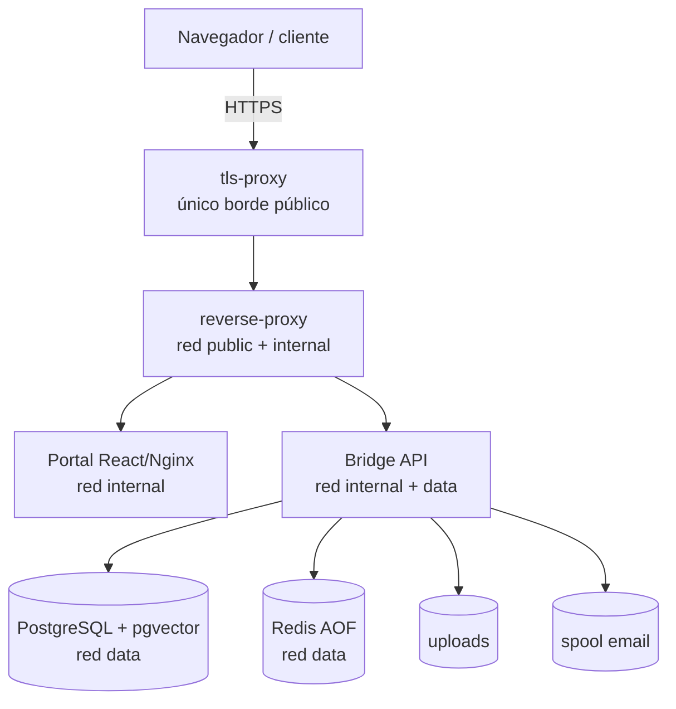
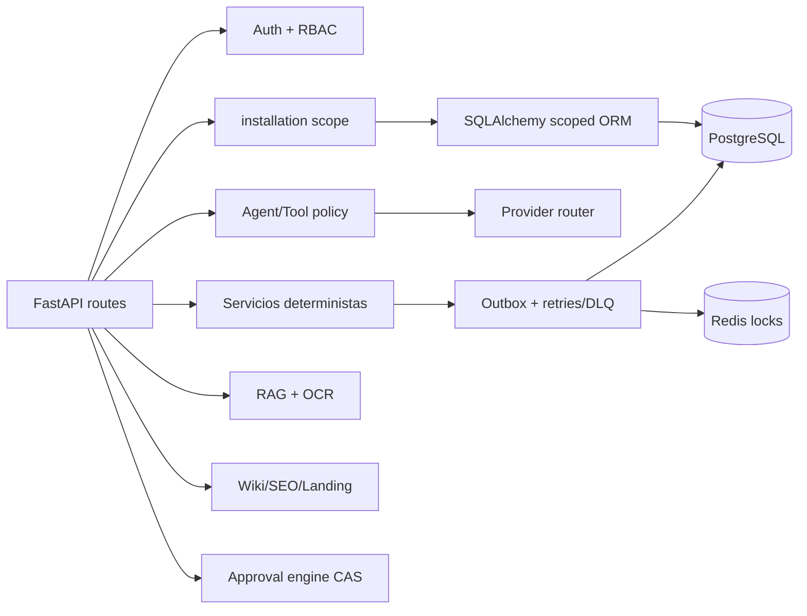
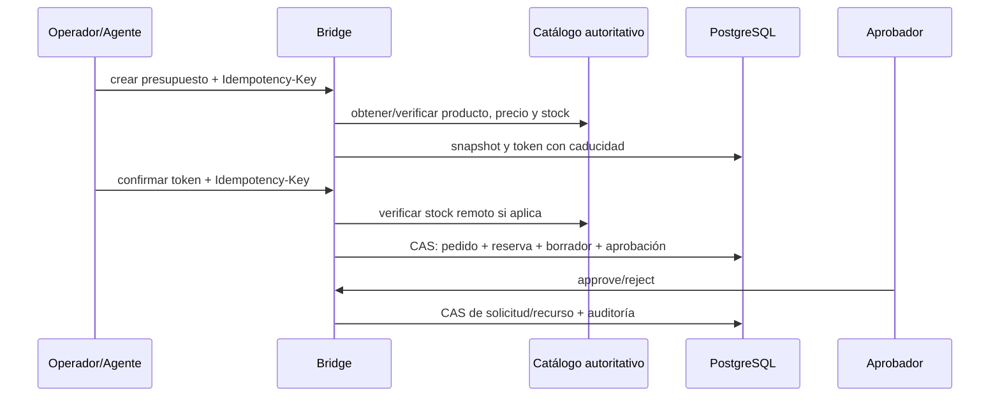

# Arquitectura de producción

## Decisiones vigentes

1. **Multi-instance single-tenant.** Cada cliente obtiene stack, DB, Redis, redes, volúmenes, secrets, dominio, manifest y backups independientes.
2. **Bridge como autoridad.** Bridge controla identidad, permisos, datos propios, finanzas deterministas, agentes, aprobaciones, RAG, publicaciones y auditoría.
3. **Core autónomo.** El perfil `production` funciona sin PrestaShop, GHL, Chatwoot, FlowWink, Activepieces ni modelos externos.
4. **Fail-closed.** DB, Redis y workers requeridos participan en readiness; los proveedores no configurados no se simulan.
5. **Draft/approval first.** Agentes y operadores preparan; las acciones sensibles pasan por un estado versionado y aprobación.
6. **Vendors desacoplados.** Solo APIs/webhooks; nunca acceso a DB de Bridge ni autoridad financiera.

## Vista de despliegue

En production, Bridge no tiene red `public`, `extra_hosts` ni ruta por defecto. `tls-proxy` publica 80/443 y deriva a un proxy interno no publicado. Todos los servicios aplican límites CPU/RAM/PID; Portal/proxies y Bridge usan filesystem read-only donde es viable.

## Vista lógica de Bridge

## Módulos y autoridad

| Módulo | Fuente de verdad | Mutaciones sensibles |
|---|---|---|
| Identidad/RBAC | Bridge DB | Crear/desactivar usuario: admin; provider role: provider_admin |
| Catálogo/CRM | Bridge DB o provider explícito | Import/sync: admin; origen y autoridad preservados |
| Presupuesto/pedido/factura | Bridge DB | Token, idempotencia, cálculo servidor; factura solo borrador/aprobación |
| Agentes/tools | Bridge DB + registro incorporado | Allowlist; activación aprobada |
| Wiki/landing | Bridge DB | Publicación local solo tras aprobación |
| SEO | Bridge DB + AuditLog | Analiza HTML suministrado; no fetch/publicación externa |
| RAG | Bridge DB + volumen | Ingesta admin; lectura por rol; citas/abstención |
| Scheduler | Bridge DB + worker | Activación aprobada; solo `automation_sweep` |
| Integraciones | Bridge adapters/outbox | HMAC/idempotencia/retry; no autoridad de reglas críticas |

## Modelo de datos

Todas las entidades operativas propias llevan `installation_id`. El ORM aplica `with_loader_criteria` a lecturas, fuerza la instalación en inserts/updates y rechaza cambios cruzados en `before_flush`. Las relaciones críticas usan claves compuestas por instalación. La separación física por proyecto/DB sigue siendo obligatoria.

La cadena Alembic vigente es lineal `0001…0026` (head `0026_agent_autonomy_extended`). Tras `0013` (tablas core de negocio: `agent_definitions`, `wiki_pages`, `seo_projects`, `landing_pages`, `scheduled_tasks`), las revisiones `0014…0026` añaden, sin borrar datos: mensajes de conversación, etapas de pipeline con `stage_changed_at`, actividades de comercial con SLA, campos personalizados, suscripciones de webhooks salientes, integración de email (plantillas/tracking), datos maestros, campañas segmentadas, escucha social, apariencia por instalación y autonomía de agentes con decisiones y revert. Los downgrades preservan las tablas intencionadamente.

## Flujos principales

### Venta asistida

### Publicación local

`draft → pending_approval → published/approved` o `rejected`. La edición usa `If-Match`; la solicitud incrementa versión; la decisión comprueba versión/estado en una única transición CAS. Wiki sanea HTML; landing escapa contenido; ambas devuelven CSP sandbox. No existe publicación externa.

### RAG local

Ingesta controlada → extracción/OCR → chunks/metadata/ACL → vectores o TF-IDF → búsqueda filtrada por instalación/rol → abstención o respuesta extractiva con citas. El perfil production usa TF-IDF local y sin egress.

## Observabilidad y disponibilidad

- `/live`: proceso vivo.
- `/health`: DB y workers en forma no sensible.
- `/health/details`: detalle solo admin.
- `/ready`: DB, Redis y workers obligatorios; 503 al degradarse.
- Logs JSON con correlation/request IDs y redacción.
- Métricas/circuit breakers/outbox/alertas internas; exportación/pager externo pendiente.

## ADR resumidos

| ADR | Decisión | Consecuencia |
|---|---|---|
| ADR-001 | Instancia única por cliente | Mayor coste operativo; aislamiento simple y auditable |
| ADR-002 | Bridge autoridad de negocio | Vendors se pueden sustituir; más responsabilidad en Bridge |
| ADR-003 | PostgreSQL, no SQLite | Mismo motor que producción; requiere contenedor/runtime |
| ADR-004 | Redis obligatorio/fail-closed | Indisponibilidad visible; no bypass de rate limit/locks |
| ADR-005 | Local TF-IDF sin egress | Core autónomo; semántica limitada y corpus acotado |
| ADR-006 | Publicación/acciones automáticas desactivadas | Más revisión humana; menor riesgo irreversible |
| ADR-007 | Release por imágenes locales registradas | Deploy reproducible; exige build/manifest previo |

## Fuera de alcance certificado

Alta disponibilidad, multi-región, Kubernetes, multi-replica Bridge, SSO/MFA, object storage, crawler SEO, SMTP/API de correo, facturación legal, publicación externa y perfil `full`.
