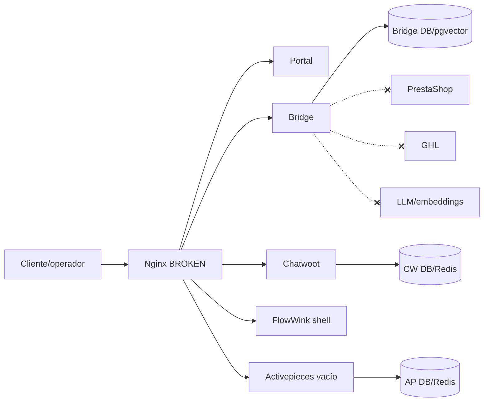
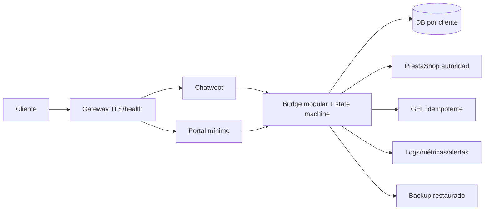

# Auditoría técnica integral — Agent Platform Fixed

## 1. Portada

**Proyecto:** `agent-platform-fixed`  
**Fecha de auditoría:** 2 de agosto de 2026  
**Workspace:** `C:\Users\PC\Desktop\PROYECTOS\agent-platform-fixed`  
**Auditoría:** arquitectura, código, DevOps, QA, seguridad, IA/RAG, integraciones, UX, operación, licencias y readiness comercial  
**Decisión:** **NO-GO — CRITICAL RISK**  
**Baseline de seguridad:** **SECURITY BASELINE FAILED**

> El proyecto no debe exponerse a clientes ni ejecutar pedidos reales. Puede presentar producto/precio/stock demo como verificado, interpretar “no acepto” como confirmación y calcular precio/stock al margen de PrestaShop.

## 2. Resumen ejecutivo

El código contiene un backend funcional en local, autenticación/RBAC razonables, HMAC compatible con Chatwoot, importación y RAG básico. Se reprodujeron 31 tests con 67 % de cobertura y el portal compila. Esa evidencia no valida el producto real: la suite usa SQLite, demo, mocks/stubs, TF-IDF local y rate limit deshabilitado.

El flujo Ofideep no funciona end-to-end. PrestaShop, GHL, Chatwoot, Activepieces y Ollama no están operativos; además, Bridge/Chatwoot/Activepieces no tienen ruta de red por defecto. Chatwoot entra en restart loop por PID obsoleto y Nginx no crea workers por una capability ausente. El puerto 9000 pertenece a otro stack fuera de alcance y el proxy de este proyecto no quedó publicado.

Existen cinco stop-ship técnicos:

1. 100 productos demo entran en la búsqueda “verificada”.
2. `no acepto` puede confirmar un pedido, reserva y borrador.
3. La cotización ignora variantes, precios específicos e impuesto real.
4. El stock se reserva solo localmente, sin autoridad PrestaShop ni ciclo de vida.
5. La migración de downgrade ejecuta `drop_all`.

El build limpio solicitado se canceló correctamente al superar 95 % de RAM. El stack auditado quedó detenido para proteger el host; los volúmenes se conservaron. Se estima **40–60 persona-días** para alcanzar un candidato a piloto controlado, sujeto a sandboxes, credenciales ficticias, host limpio y revisión legal.

## 3. Alcance

- Código propio completo: Bridge, Portal, infraestructura, scripts, migraciones y tests.
- Runtime Docker y datos del proyecto `agent-platform-fixed` sin PII.
- Vendor focalizado: README, licencia, Dockerfile, manifiestos, APIs/webhooks usados y código Chatwoot necesario para verificar firmas.
- Toolchain, composición, dependencias, tests, cobertura, build, seguridad, arquitectura, operación, DR, UX y comercialización.
- Documentación previa contrastada con código/runtime.

## 4. Exclusiones

- No se leyó vendor completo, node_modules, binarios, caches, backups ni logs históricos completos.
- No hubo pruebas ofensivas externas, datos reales, envío a GHL/PrestaShop o operaciones destructivas.
- DAST, escaneo de imágenes, SBOM final, carga y Playwright quedaron BLOCKED por RAM/runtime.
- No se declara asesoramiento legal, certificación, SLA, RPO/RTO o benchmark no medido.

## 5. Metodología

Se aplicó una cadena de evidencia: lectura → configuración efectiva → análisis estático → test local → runtime → integración → e2e. Una capacidad solo recibe `VERIFIED` cuando su prueba real fue reproducible. Se usaron exclusivamente los estados solicitados. Se sanitizaron variables y se extrajeron solo logs relevantes. Al superar RAM 90 %, se canceló trabajo pesado.

Informes de fase: [`docs/audit/01_BASELINE.md`](audit/01_BASELINE.md) a [`docs/audit/22_30_60_90_DAY_PLAN.md`](audit/22_30_60_90_DAY_PLAN.md).

## 6. Entorno

| Elemento | Evidencia |
|---|---|
| SO | Windows 11 Pro build 26200 |
| CPU/GPU | Intel Core Ultra 9 275HX, 24 lógicos; Intel Graphics + RTX 5070 Laptop |
| RAM | 31,46 GiB; 81,2 % usada pre-build; 95,3 % durante build |
| Disco | C: 925,14 GiB; 161,38 GiB libres en baseline |
| Docker | 29.5.3, overlayfs, 24 CPU/15,35 GiB asignados |
| Compose | 5.1.4 |
| Python/Node/npm/pnpm | 3.11.7 / 24.13.0 / 11.6.2 / 10.33.2 |

## 7. Versión y commit

- Workspace Git: **BLOCKED**; no existe `.git`, por lo que rama, commit, tags, diff y submódulos son desconocidos.
- Bridge `pyproject`: 0.9.1; dashboard runtime: `0.9.1-security-remediation` hardcoded.
- Vendor declarado: FlowWink `0cd4e9...`, Chatwoot `b05f22...`/4.16.2, Activepieces `44143d...`/0.86.3.
- Los hashes existen en GitHub y 11/12 archivos representativos coinciden tras normalizar CRLF. Dockerfile Chatwoot tiene un fallback temporal local no declarado. Sin Git no se prueba limpieza integral.

## 8. Arquitectura actual

El diseño pretende multi-instance single-tenant. DB/red/volumen por proyecto sí aíslan, pero actualización, restore, eliminación y prueba negativa cruzada no están verificados. Bridge es monolito/SPOF y replica dominios de PrestaShop/GHL/Chatwoot.

## 9. Arquitectura recomendada

Retirar FlowWink y Activepieces del MVP; hacer PrestaShop autoridad de producto/precio/stock/pedido; usar outbox/idempotencia, egress allowlisted y releases inmutables.

## 10. Inventario

Compose declara 14 servicios, 3 redes y 9 volúmenes. Código propio: FastAPI/Python y React/TypeScript. Datos: tres PostgreSQL, tres Redis/cache y uploads. Integraciones: PrestaShop, GHL, Chatwoot, Activepieces, Ollama/cloud LLM. RAG: pgvector/TF-IDF/OCR. Inventario detallado: [`02_COMPONENT_INVENTORY.md`](audit/02_COMPONENT_INVENTORY.md).

## 11. Estado de servicios

| Servicio | Estado | Evidencia funcional observada |
|---|---|---|
| Proxy | BROKEN | Master sin workers, health leak y sin publicación efectiva |
| Portal | PARTIALLY VERIFIED | Build y upstream estático; UX runtime bloqueada |
| Bridge | PARTIALLY VERIFIED | Health, ready, login, dashboard y DB reales |
| Bridge DB | VERIFIED | 1 usuario, 25 clientes demo y 100 productos demo consultados |
| Bridge Redis | CONFIGURED ONLY | Healthy, sin flujo funcional verificado |
| FlowWink | BROKEN | SPA servida sin Supabase operativo |
| Chatwoot Web | BROKEN | PID obsoleto y restart loop |
| Chatwoot Worker | PARTIALLY VERIFIED | Arranque observado, sin conversación e2e |
| Chatwoot DB | VERIFIED | Esquema y recuentos consultados; sin filas de negocio |
| Chatwoot Redis | CONFIGURED ONLY | Healthy, sin flujo funcional verificado |
| Activepieces App | CONFIGURED ONLY | Healthy, sin proyectos ni flujos |
| Activepieces Worker | BROKEN | Errores RPC/polling y sin ejecución real |
| Activepieces DB | VERIFIED | 79 tablas y cero filas consultadas |
| Activepieces Redis | CONFIGURED ONLY | Healthy, sin flujo funcional verificado |

Al cierre, todos los contenedores del proyecto están detenidos por seguridad de memoria; esto no borró volúmenes.

## 12. Estado de capacidades

Autenticación es la única capacidad transversal `VERIFIED`. Productos, stock, pedidos, reservas, conversaciones, agentes, automatización y costes están `BROKEN`. Categorías, factura real, SEO, exportación, monitorización, alertas y data lifecycle están `NOT IMPLEMENTED`. Matriz completa: [`08_CAPABILITY_MATRIX.md`](audit/08_CAPABILITY_MATRIX.md).

## 13. Calidad de código

- Ruff: 297; Black: 21 archivos; MyPy: 71 errores; Prettier: 5 archivos; ESLint sin config.
- TypeScript y build Portal pasan.
- Bandit: 0 altas/medias, 2 bajas.
- `main.py` 1.192 líneas; agents/rate limit en memoria; adapters sin resiliencia; migración destructiva.
- Python sin lock/hash; imágenes sin digest.

## 14. Calidad de tests

31/31 pasan con 67 % de cobertura. La suite es reproducible pero local/simulada: SQLite, demo, stubs, mock LLM, TF-IDF y rate limit off. No cubre integración real, proxy, PostgreSQL, concurrencia, restore, update, performance o frontend. El test “solo catálogo verificado” no excluye demo y es falso positivo semántico.

## 15. Integraciones

- **PrestaShop:** adapter rico, solo mock; no credencial/egress; datos obtenidos no se aplican correctamente a precio/pedido.
- **GHL:** payload básico, solo mock; no atomicidad/retry/reconcile.
- **Chatwoot:** HMAC compatible por revisión vendor; runtime/account/widget inexistentes.
- **Activepieces:** sin flujos/API key; adapter fabrica ID en 2xx.
- **LLM/Ollama:** `Network is unreachable`; cloud keys vacías.

## 16. MVP de Ofideep

**BROKEN.** No existe el recorrido cliente→agente→PrestaShop→GHL→handoff. El chat es heurístico, puede usar demo, no captura datos posteriores, no hace pedido PrestaShop y no asigna humano. Criterios: [`09_OFIDEEP_MVP_GAP_ANALYSIS.md`](audit/09_OFIDEEP_MVP_GAP_ANALYSIS.md).

## 17. Seguridad

**SECURITY BASELINE FAILED.** Positivos: auth, revocación, RBAC parcial, HMAC, CORS y Bridge nonroot/read-only. Fallos: integridad comercial P0, rate spoofable, staging no usado, TLS incompleto, dependencias vulnerables, vendor root, RAG denylist evadible, coste/kill switch inerte, backup no restaurado, no egress policy utilizable y no observabilidad.

## 18. Rendimiento

No hubo benchmark. Una instantánea mostró AP app 50,55 % CPU/945,8 MiB, AP Redis 37,08 %, CW worker 38,74 %/499,6 MiB y tráfico AP↔Redis elevado. Puede reflejar loops; no se presenta como steady state. RAG, sync/import y costes contienen patrones O(n)/N+1.

## 19. Escalabilidad

Una instalación completa ya está rota. 5 clientes implicarían 70 servicios y riesgo alto en un host; 10+ no son factibles con operación manual. 25–100 requieren orquestación, telemetry, releases, capacity/cost model y quizá data plane por cliente con control plane; no se recomienda SaaS compartido sin demanda/aislamiento demostrados.

## 20. RAG

Ingesta TXT/PDF/DOCX/XLSX/images, OCR, chunks, vectores, citas y ACL están parcialmente implementados. Tests usan TF-IDF, no embeddings reales. Runtime tiene 0 documentos. Carga todos los chunks, ACL por defecto amplia, filtro de secretos por substrings, sin MIME/AV/DLP/reranker/evals.

## 21. Modelos

Configurados Ollama Qwen 3B/7B y Nomic Embed, pero no accesibles. OpenAI/Anthropic sin key. Coste siempre 0. No se verificaron pesos, versión, licencia, calidad, latencia ni fallback. `/agents/run` no tiene tools ni grounding obligatorio.

## 22. UX

Build/typecheck pasan y UI visible está en español por código. Tema y breakpoints existen, no se probaron visualmente. Links a cinco módulos ausentes; i18n anuncia muchos más. Branding genérico, datos demo/configuración pueden parecer reales, no frontend tests/axe y 401 no reautentica. Capturas honestamente BLOCKED.

## 23. Operación

No hay logs centralizados, tracing, dashboards, alertas, SLO, runbooks ensayados, certificate/disk monitor ni queue visibility. Health da falsos positivos. No puede detectarse de forma automática chat sin respuesta, pedido duplicado, backup fallido o coste anómalo.

## 24. Backups

Scripts incluyen tres dumps y dos volúmenes, checksums y cifrado. Omiten Redis/AP cache/config/TLS/FlowWink externo, no coordinan snapshot y no tienen retención/offsite/alerta. La instancia actual no sigue su convención. Estado `IMPLEMENTED BUT NOT TESTED`.

## 25. Recuperación

`BLOCKED`: no hubo restore completo, por lo que RPO/RTO son desconocidos. Restore limpia destinos y confía en health defectuoso. Debe probarse en proyecto aislado con hashes, conteos y flujo funcional.

## 26. Actualizaciones

`BROKEN`: scripts requieren Git ausente y hacen checkout global. No hay registry/digest/firma/canary/matriz de schema. Downgrade puede borrar datos.

## 27. Licencias

FlowWink MIT. Chatwoot/Activepieces separan rutas EE, que están presentes. El notice “Enterprise excluded” es incorrecto. Código propio no tiene licencia raíz. Modelos/SBOM no inventariados. Fuentes oficiales: [licencia Activepieces](https://github.com/activepieces/activepieces/blob/main/LICENSE) y [repositorio Chatwoot](https://github.com/chatwoot/chatwoot).

## 28. Preparación comercial

**FAILED.** No deben venderse como reales: agente tool-calling, catálogo/stock/precio, GHL/chat e2e, facturación, SEO, backup verificado, alertas, SLA o escalabilidad. Faltan ownership legal, NOTICE/SBOM, DPA/retención/export/delete, onboarding probado, soporte y aceptación.

## 29. Defectos

30 defectos registrados: 5 P0, 21 P1 y 4 P2; no se registraron P3. Registro con raíz, esfuerzo y regresión: [`18_DEFECT_REGISTER.md`](audit/18_DEFECT_REGISTER.md).

## 30. Riesgos

Stop-ship: datos comerciales incorrectos, consentimiento, recuperación. Altos: integraciones, duplicados, recursos, RAG, costes, observabilidad, licencias, supply chain, upgrades, aislamiento y privacidad. Registro: [`19_RISK_REGISTER.md`](audit/19_RISK_REGISTER.md).

## 31. Deuda técnica

Principales: state machine ausente, catálogo incoherente, migración destructiva, adapters sin resiliencia, estado en memoria, supply chain flotante, vendor sprawl, observabilidad, scripts duplicados y documentación manual. No ejecutar refactor big-bang antes de fijar tests P0.

## 32. Mejoras recomendadas

1. Eliminar demo del plano cliente y fijar ownership PrestaShop.
2. State machine + idempotencia/outbox/locks para comercio y GHL.
3. Stack MVP mínimo: Bridge, Portal, Chatwoot y DB; retirar componentes sin uso.
4. Egress allowlisted, TLS, proxy/health, límites y staging fail-closed.
5. Restore probado, releases inmutables, SBOM y observabilidad.

## 33. Roadmap

0–7 días: stop-ship, proxy/CW/red/recursos/deps y simplificación. 2–4 semanas: Presta/GHL/chat e2e, DR, observabilidad, QA/UX/legal. 1–3 meses: release platform, RAG seguro, onboarding/aislamiento/cost model. 3–12 meses: HA/regiones/marketplace solo tras demanda. Véase [`21_REMEDIATION_ROADMAP.md`](audit/21_REMEDIATION_ROADMAP.md).

## 34. Esfuerzo

- Candidato a piloto: **40–60 persona-días**, 4–8 semanas calendario con equipo paralelo.
- Producto repetible: **3–6 persona-meses adicionales**.
- No incluye HA/SaaS/marketplace ni espera de terceros. Recalibrar después de medir runtime estable.

## 35. Decisión final

# NO-GO — CRITICAL RISK

La decisión solo puede revisarse cuando no queden P0, PrestaShop/GHL/Chatwoot estén verificados e2e, el backup haya sido restaurado, el stack sobreviva reboot/soak con recursos seguros y seguridad/licencias/privacidad tengan aceptación formal.

## Tabla maestra

| ID | Área | Capacidad | Estado | Evidencia | Problema | Impacto | Prioridad | Esfuerzo | Solución | Criterio de aceptación |
|---|---|---|---|---|---|---|---|---|---|---|
| M-01 | Repo | Trazabilidad | BLOCKED | Sin `.git` | Commit/diff desconocido | Release no reproducible | P1 | M | Restaurar repo/release metadata | SHA/tag verificable |
| M-02 | Datos | Productos | BROKEN | 100 demo | Demo como verificado | Oferta falsa | P0 | S | Excluir demo | Cero demo en cliente |
| M-03 | Chat | Consentimiento | BROKEN | Substring | Negación confirma | Pedido no autorizado | P0 | M | State machine | Matriz adversarial pasa |
| M-04 | Commerce | Precio | BROKEN | Código pricing | Ignora specific/variant/IVA | Importe incorrecto | P0 | L | Precio Presta snapshot | Golden contracts |
| M-05 | Commerce | Stock | BROKEN | Reserva local | No autoridad/TTL | Oversell | P0 | L | Reserva/pedido Presta | Concurrencia sin oversell |
| M-06 | DB | Migraciones | BROKEN | `drop_all` | Downgrade destructivo | Pérdida datos | P0 | M | Migrations explícitas | Fixture preservado |
| M-07 | Network | Egress | BROKEN | Sin default route | APIs inaccesibles | MVP inutilizable | P1 | M | Egress allowlist | Solo destinos autorizados |
| M-08 | Proxy | Entrada | BROKEN | setuid/no workers | Capability errónea | Sin acceso | P1 | S | Nginx unprivileged | HTTP/health/reboots |
| M-09 | Chatwoot | Web | BROKEN | PID stale | Restart loop | Chat caído | P1 | S | Entrypoint robusto | 10 reinicios sanos |
| M-10 | Host | Recursos | BLOCKED | RAM 95,3 % | Sin limits/loops | Inestabilidad | P1 | M | Límites/capacity | Idle/soak dentro budget |
| M-11 | Auth | Login | VERIFIED | Login runtime/tests | Controles avanzados faltan | Riesgo residual | P2 | M | MFA/lock/aud-iss | Security tests |
| M-12 | RBAC | Permisos | PARTIALLY VERIFIED | Tests viewer/admin | Matriz/races | Acceso indebido | P1 | M | Policy tests/CAS | Cada ruta/rol validado |
| M-13 | GHL | Lead | BROKEN | Mock/código | Sin creds/egress/idempotencia | Duplicados | P1 | L | Outbox/upsert | Fault injection |
| M-14 | Chatwoot | Webhook | IMPLEMENTED BUT NOT TESTED | Firma vendor compatible | Sin account/e2e | Chat sin respuesta | P1 | L | Onboarding e2e | Mensaje visible |
| M-15 | Chatwoot | Handoff | BROKEN | Solo status open | No asignación | Lead abandonado | P1 | M | Team/agent assignment | Agente humano lo recibe |
| M-16 | Activepieces | Workflows | BROKEN | DB 0/fake ID | Sin flujo real | Automatización falsa | P1 | S/M | Retirar o validar | Execution ID/estado real |
| M-17 | FlowWink | Agentes | BROKEN | Supabase vacío | Shell estático | Complejidad/promesa falsa | P1 | S | Retirar MVP | No servicio/promesa muerta |
| M-18 | AI | Tool calling | NOT IMPLEMENTED | allowed_tools inerte | LLM libre separado | Alucinación | P1 | L | Tool loop allowlist | Evals sin tool bypass |
| M-19 | AI | Costes | BROKEN | Coste siempre 0 | Budget inerte | Coste runaway | P1 | M | Usage/tarifario/hard limit | Límite se dispara |
| M-20 | RAG | Búsqueda | PARTIALLY VERIFIED | TF-IDF tests | No remote/runtime | Calidad desconocida | P1 | L | Evals/embedding real | Recall/latencia umbral |
| M-21 | RAG | Seguridad | BROKEN | Denylist | Exfil evadible | Fuga datos | P1 | L | ACL/DLP/policy | Dataset exfil pasa |
| M-22 | Import | Productos/datos | PARTIALLY VERIFIED | Tests local | N+1/no escala/export | Operación manual | P2 | M | Batch/upsert/export | 10k limitado/roundtrip |
| M-23 | Backup | Copia | IMPLEMENTED BUT NOT TESTED | Scripts | Incompleta/inconsistente | Sin protección demostrada | P1 | L | Snapshot/manifiesto | Backup fixture válido |
| M-24 | DR | Restore | BLOCKED | Nunca ejecutado | RPO/RTO desconocidos | Riesgo existencial | P0 | L | Restore aislado | Hashes/flujo/RTO medidos |
| M-25 | Release | Update/rollback | BROKEN | Sin Git | Checkout global | No parche seguro | P1 | L | Images/digests | Upgrade+rollback por cliente |
| M-26 | Supply | Dependencias | BROKEN | pip/npm audit | Parsers/Vite vulnerables | Seguridad | P1 | M | Update/lock/scan | Audits y corpus pasan |
| M-27 | Docker | Contenedores | PARTIALLY VERIFIED | Inspect | Root/no limits/tags | Blast radius | P1 | M | Harden/digests | Policy scan pasa |
| M-28 | QA | Backend tests | PARTIALLY VERIFIED | 31/31, 67 % | Mocks/falsos positivos | Falsa confianza | P1 | L | Test pyramid real | Ruta crítica sin mocks |
| M-29 | QA | Frontend tests | NOT IMPLEMENTED | Sin runner | Regresión/a11y | UX rota | P2 | M | Component/E2E/axe | CI pasa viewports |
| M-30 | UX | Navegación | BROKEN | Anchors sin sección | Producto fantasma | Confusión comercial | P2 | M | Recortar/implementar | Todo link funcional |
| M-31 | Ops | Health | BROKEN | 200 degradado/master vivo | Falso positivo | Incidente invisible | P1 | S | Liveness/readiness | Fallos cambian estado/código |
| M-32 | Ops | Alertas | NOT IMPLEMENTED | Sin collector | No detección | SLA imposible | P1 | L | OTel/metrics/alerts | Fault injection alerta |
| M-33 | Privacy | Lifecycle | NOT IMPLEMENTED | Sin export/delete | Retención/lock-in | Legal | P1 | L | Export/erase auditado | Fixture eliminado/exportado |
| M-34 | License | Redistribución | BLOCKED | EE presente/no LICENSE raíz | Derechos inciertos | Bloqueo venta | P1 | M | Legal/NOTICE/SBOM | Artefacto aprobado |
| M-35 | Commercial | Piloto | BROKEN | Gaps anteriores | Scope no real | Daño cliente | P0 | 40–60 d | Roadmap/gates | Todos gates día 90 |

---

**Documentos de evidencia:** [`audit/evidence/`](audit/evidence/)  
**Plan 30/60/90:** [`audit/22_30_60_90_DAY_PLAN.md`](audit/22_30_60_90_DAY_PLAN.md)
