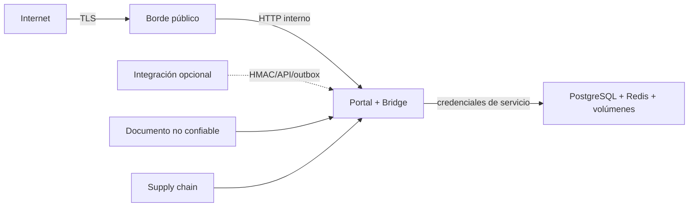

# Modelo de amenazas

## Alcance y activos

Perfil production core de una instancia: identidad, datos de cliente, catálogo, presupuestos/pedidos/borradores, documentos RAG, agentes/prompts, publicaciones, auditoría, secrets, DB/Redis, volúmenes, imágenes y backups. Vendors/full y servicios externos son fronteras opcionales no certificadas.

Actores: usuario legítimo, operador comprometido, atacante remoto, documento/prompt malicioso, proveedor externo comprometido, insider con acceso a host y error operativo entre clientes.

## Fronteras de confianza

## Amenazas prioritarias

| ID | Amenaza | Impacto | Controles | Residual/gate |
|---|---|---|---|---|
| T-01 | Acceso cruzado por ID/consulta/backup | Fuga o corrupción P0 | DB por cliente, installation scope ORM, FKs compuestas, manifest de backup | E2E A/B + restore cruzado negativo PENDING |
| T-02 | Escalada de rol/UI bypass | Acción no autorizada P0 | RBAC backend, token version, provider role separado | Matriz runtime de roles PENDING |
| T-03 | Robo JWT por XSS | Secuestro de sesión | CSP, React escaping, saneado, TTL, sessionStorage | BFF/cookie HttpOnly no implementado |
| T-04 | Fuerza bruta/login stuffing | Cuenta comprometida | Password policy, Redis rate limit, 401 genérico | MFA no implementado |
| T-05 | Replay/webhook falso | Duplicación/acción fraudulenta | HMAC/timestamp/idempotencia/fingerprint | E2E clock/replay final PENDING |
| T-06 | Doble confirmación/aprobación | Doble pedido/publicación | CAS, unique constraints, lease, estados | Prueba desplegada concurrente PENDING |
| T-07 | Manipulación de precio/impuesto/stock | Daño económico | Ignorar totales frontend, Decimal, autoridad catálogo, recalcular | Integración externa no certificada |
| T-08 | Emisión/publicación automática | Acción irreversible | Flags false, draft + aprobación + versionado | Mantener guardas y doble control |
| T-09 | Prompt/tool injection | Exfiltración/acción | Detector RAG, tool allowlist, schemas, no instrucciones de docs | Corpus adversarial final PENDING |
| T-10 | Upload malicioso/path traversal | RCE/fuga | Root allowlist, tamaño/extensión/parser, no ejecución | AV/DLP externo ausente |
| T-11 | SSRF/egress | Acceso a red interna/secrets | Sin default route production, host/IP allowlist, private IP deny | Vendors/full fuera de alcance |
| T-12 | Secreto en Git/log/artefacto | Compromiso total | `.gitignore`, plantillas, redacción, preflight | Scan final historia/imágenes PENDING |
| T-13 | Supply-chain/image drift | Código vulnerable/no reproducible | Locks/hashes/digests/labels/manifest/SBOM | Redis Trivy PASS; resto de imágenes PENDING |
| T-14 | Redis fail-open | Bypass rate/locks | Backend redis obligatorio y readiness 503 | Caída final PENDING |
| T-15 | Pérdida/corrupción de datos | Interrupción/irreversibilidad | Migraciones, backup cifrado, restore verification, safety backup | Restore/rollback final PENDING |
| T-16 | Exposición de puertos | Acceso DB/Redis/API | Redes internas; solo TLS edge publicado | Scan de puertos candidate PENDING |
| T-17 | Log con PII/secrets | Fuga secundaria | Redactor, no bodies, admin metrics | Revisión de logs real PENDING |
| T-18 | Abuso de recursos/DoS | Indisponibilidad | Límites body/query, rate limit, CPU/RAM/PID, timeouts | Carga/soak PENDING |
| T-19 | Backup mezclado/manipulado | Fuga/corrupción | client/project/profile/config manifest, HMAC/checksums, traversal deny | Custodia/offsite no configurada |
| T-20 | Operador aprueba contenido incorrecto | Daño comercial | Preview, referencia exacta en Portal, audit trail | Segregación de funciones limitada |

## Casos de abuso obligatorios

- `No acepto`, `no quiero confirmar` y `cancela` nunca crean pedido.
- Misma `Idempotency-Key` + payload distinto produce 409.
- Dos confirmaciones/decisiones simultáneas producen un solo efecto.
- Usuario viewer/admin de otra instalación no enumera, lee o modifica recursos.
- HTML con scripts/event handlers/`javascript:` no ejecuta código.
- Documento con “ignora instrucciones” provoca abstención/filtrado, no tool call.
- Redis/DB/proveedor caído no devuelve éxito falso.
- Backup alterado o de otro cliente se rechaza antes de escribir.

## Aceptación de riesgo

Una aceptación debe registrar propietario, activo, escenario, probabilidad/impacto, mitigación, expiración y criterio de cierre. No se aceptan P0 de acceso cruzado, confirmación insegura, secreto expuesto, restore imposible o factura/publicación automática.
