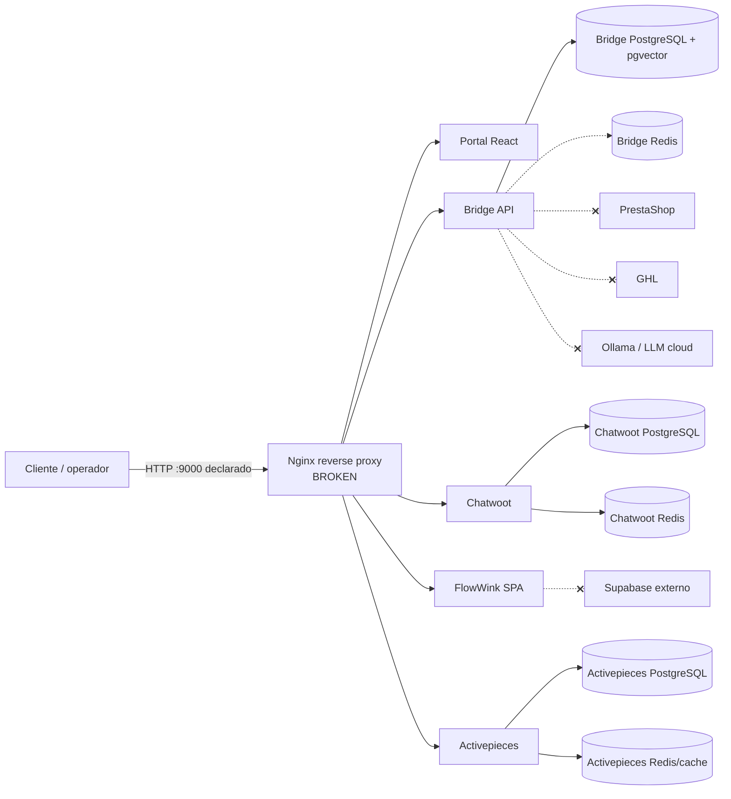
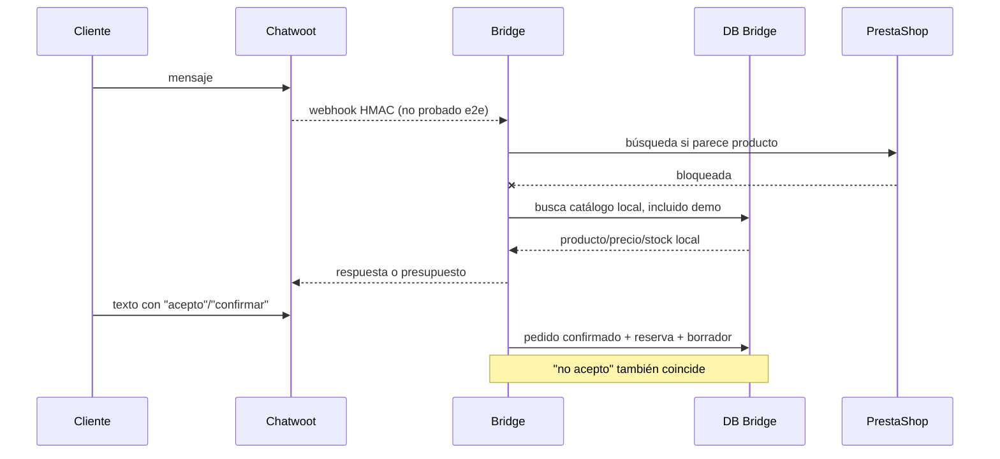
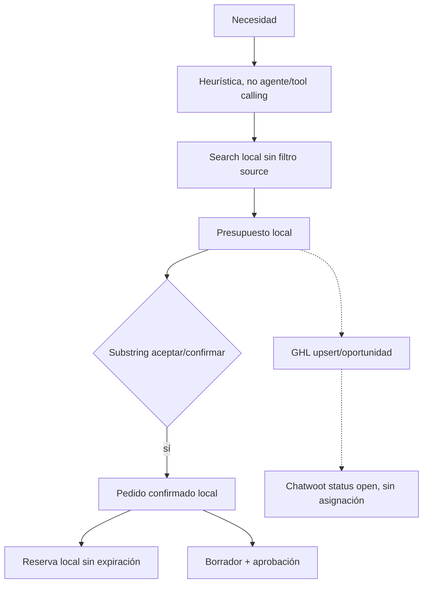
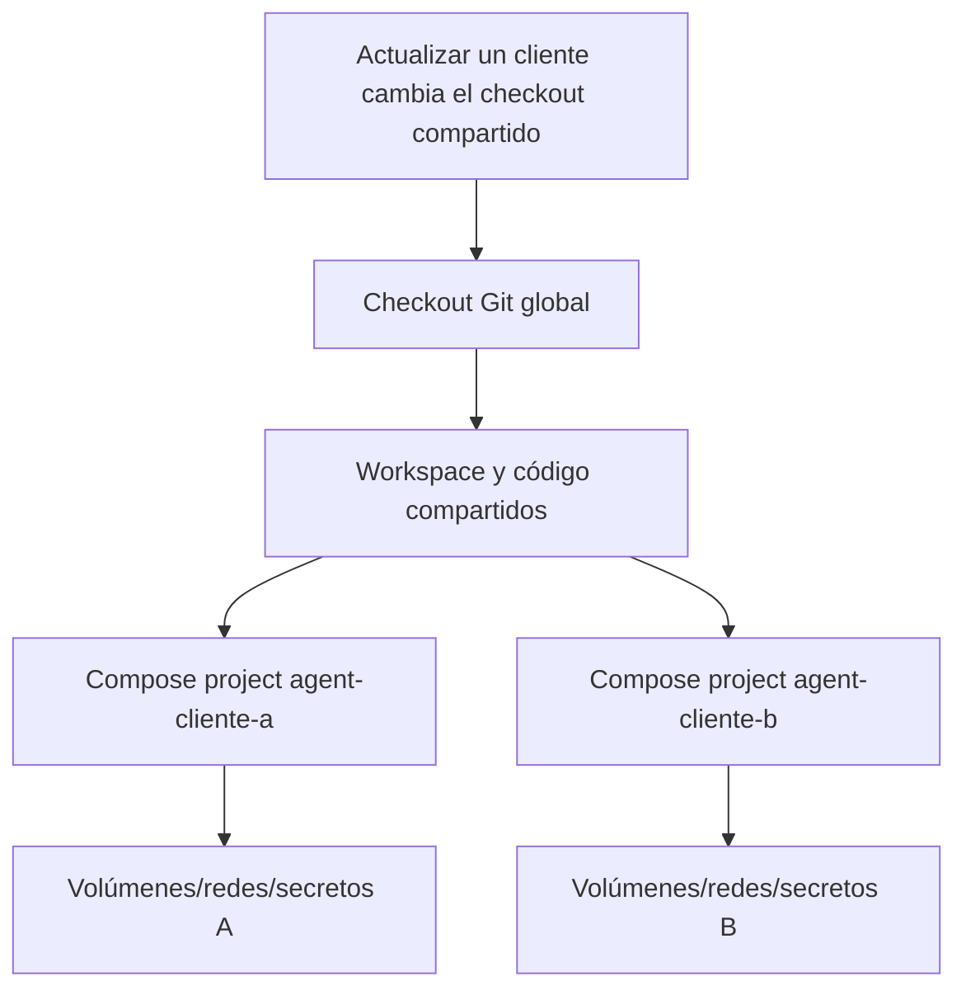
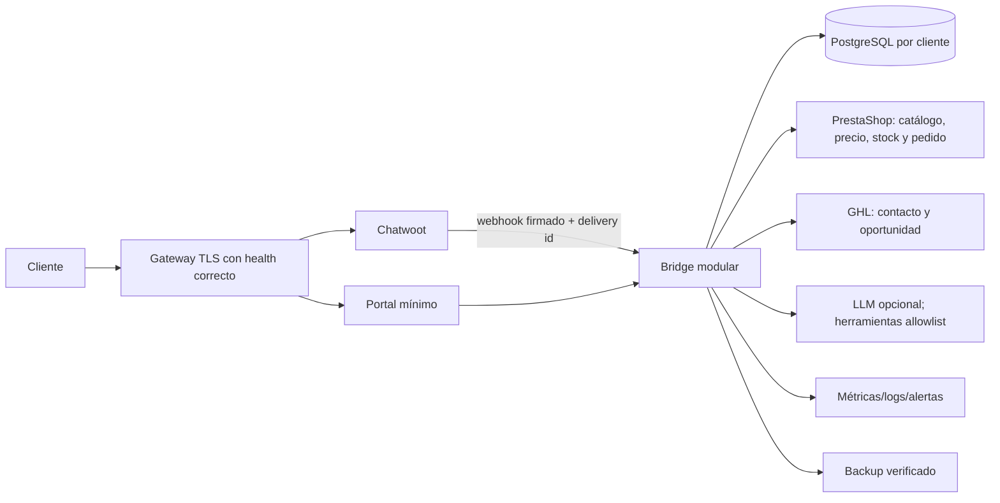

> **SUPERSEDED — NO UTILIZAR PARA DECISIONES ACTUALES.** Evidencia histórica de una fase/commit anterior. Se conserva para trazabilidad; el estado vigente está en `docs/PRODUCTION_READINESS.md` y los informes de 2026-08-15.

# 05 - Revisión de arquitectura

## Veredicto arquitectónico

El patrón pretendido es **MULTI-INSTANCE SINGLE-TENANT**, pero solo está **PARTIALLY VERIFIED**. Compose puede aislar nombres, redes, DB, Redis, volúmenes y secretos mediante `-p agent-<cliente>` y `.env.<cliente>`. No están verificadas la eliminación segura, restauración, actualización independiente ni ausencia de acceso cruzado bajo error de configuración. La instalación auditada ni siquiera sigue la convención de scripts.

## Arquitectura actual

Las líneas con `x` están bloqueadas por ausencia de credenciales y/o ruta por defecto.

## Flujo conversacional actual

## Flujo comercial y datos

## Despliegue por cliente pretendido

## Responsabilidades y duplicación

- Bridge concentra autenticación, negocio, orquestación, integraciones, RAG, telemetría y configuración de agentes: demasiadas razones de cambio.
- PrestaShop y Bridge compiten por producto/precio/stock/pedido.
- FlowWink, registro en memoria de Bridge y Activepieces solapan configuración/ejecución de agentes y workflows sin integración real.
- Chatwoot y Customer local duplican identidad/contacto; GHL añade una tercera copia.
- Proxy y Bridge son puntos únicos de fallo; no hay HA ni failover.

## Arquitectura recomendada para piloto

Para el MVP: retirar FlowWink y Activepieces del camino crítico; usar una máquina de estados en Bridge; mantener Chatwoot solo como canal; hacer de PrestaShop la autoridad transaccional; persistir idempotencia/outbox; añadir egress controlado por allowlist.

## Evaluación multi-instance

| Control | Estado | Evidencia/fallo |
|---|---|---|
| Proyecto Compose por cliente | PARTIALLY VERIFIED | Scripts lo generan; instancia actual usa nombre manual |
| DB/Redis/redes/volúmenes independientes | VERIFIED | Nombres por proyecto y recursos separados observados |
| Secretos/config independientes | IMPLEMENTED BUT NOT TESTED | `.env.<cliente>`; plaintext y sin gestor |
| Backup independiente | IMPLEMENTED BUT NOT TESTED | Script parametrizado; no restaurado |
| Actualización independiente | BROKEN | Checkout Git global y workspace sin `.git` |
| Eliminación segura | NOT IMPLEMENTED | No script, borrado criptográfico ni evidencia |
| Ausencia de acceso cruzado | PARTIALLY VERIFIED | Redes separadas; no prueba negativa ni guardas en tablas |

## Archivos revisados

Compose/overrides, proxy, modelos, rutas, servicios, scripts de ciclo de vida y documentos de arquitectura/decisiones.

## Defectos, riesgos y pendiente

- Arquitectura distribuida demasiado grande para un MVP no integrado.
- No hay egress controlado: hay aislamiento, pero también inutilidad funcional.
- Actualización y recuperación no cumplen independencia real.
- Pendiente: prueba de aislamiento con dos instalaciones ficticias, destrucción segura y sandbox e2e.
