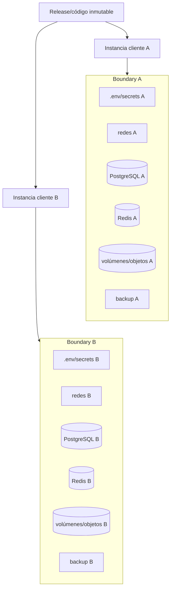
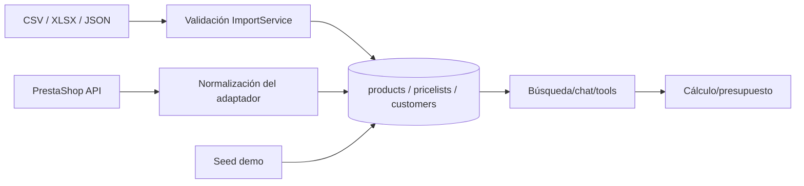
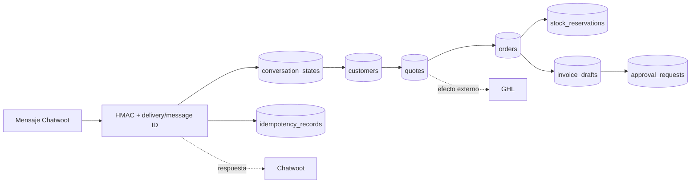
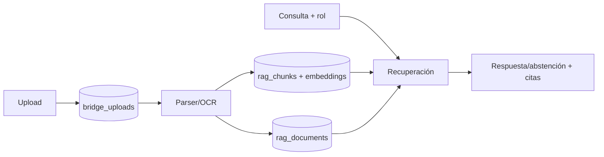
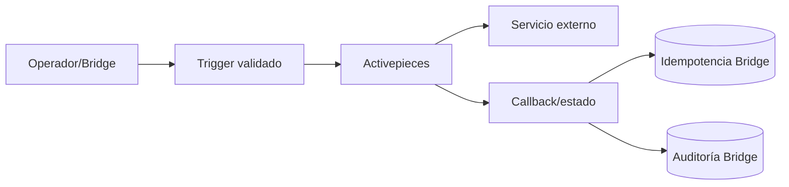

# Propiedad, autoridad y aislamiento de datos

## 1. Principio de despliegue

La estrategia de partida es **multi-instance single-tenant**. Cada cliente debe ejecutarse como un proyecto Compose independiente y tener, como mínimo:

- `INSTALLATION_ID`, archivo de configuración y secretos propios.
- PostgreSQL, Redis, redes y volúmenes con nombres de proyecto propios.
- Dominio/puerto, logs, backup, actualización y restore identificables por cliente.
- Ninguna consulta o ruta que pueda seleccionar otra instalación desde la misma base de datos.

El código actual solo aplica `installation_id` de manera explícita a `users` y al token de acceso. Las demás tablas propias no tienen una columna de tenant. Esto es compatible con una DB dedicada por instalación, pero **no aporta defensa en profundidad** ante una DB/volumen reutilizado por error. El aislamiento no debe declararse probado hasta ejecutar tests cruzados de bases, archivos, IDs, backups y credenciales.

## 2. Evidencia de datos observada

La auditoría anterior inspeccionó el runtime real antes de detenerlo:

| Almacén | Contenido observado | Lectura correcta de la evidencia |
|---|---|---|
| Bridge PostgreSQL | 1 usuario, 25 clientes demo, 100 productos `source=demo`; 0 presupuestos, pedidos, reservas, facturas, aprobaciones, documentos, chunks, auditorías e idempotencias | La DB y el esquema existían; no había actividad comercial real y el catálogo era demo |
| Chatwoot PostgreSQL | ~19 MB, 98 tablas y sin filas de negocio estimadas | El esquema existía; no demuestra onboarding, inbox, conversación ni handoff |
| Activepieces PostgreSQL | ~13 MB, 79 tablas y 0 filas | El esquema existía; no había proyectos, flujos ni ejecuciones reales |
| Volúmenes de archivos/cache | Volúmenes creados; corpus RAG runtime vacío | Existencia física no equivale a backup, restore ni ownership validado |

Todos los contenedores están detenidos en la captura actual. No se hicieron escrituras ni se consultaron credenciales para este documento.

## 3. Matriz de propiedad actual

| Dominio | Almacén físico actual | Escritor actual | Lectores actuales | Autoridad efectiva encontrada | Conflicto o vacío |
|---|---|---|---|---|---|
| Configuración de instalación | `.env` o `.env.<cliente>` | Script/operador | Compose y aplicaciones | Archivo por instalación | Secretos plaintext; no incluido en backup integral ni secret manager |
| Usuarios, contraseña, rol y sesión | `users` en Bridge DB | Bridge | Bridge/Portal | Bridge | Es la única entidad con `installation_id`; roles no son aún granulares |
| Token de navegador | `sessionStorage` | Portal | Portal | Navegador durante la sesión | Accesible a JS del mismo origen; no es un almacén servidor |
| Cliente/contacto local | `customers` en Bridge DB | Seed, importador, webhook Chatwoot | Bridge comercial/GHL adapter | Bridge en la práctica | Chatwoot y GHL pueden mantener copias sin reconciliación/ID canónico robusto |
| Contacto/conversación Chatwoot | Chatwoot DB | Chatwoot | Chatwoot y Bridge vía webhook/API | Chatwoot para conversación | DB vacía; handoff y asignación no probados |
| Contacto/oportunidad GHL | GHL externo | Bridge adapter/GHL | GHL/Bridge por respuesta | No establecido en runtime | Efectos externos sin outbox atómico y sin credenciales/sandbox |
| Producto y catálogo normalizado | `products` en Bridge DB | Seed, importador, sync PrestaShop | Chat, tools y cálculos | Bridge en la práctica | Mezcla `demo`, `local`, `import` y `prestashop`; búsqueda no filtra origen |
| Categorías/características/variantes | String/JSON en `products` | Sync/import | Bridge | Copia no normalizada | Variantes y precios específicos se almacenan en JSON, pero no gobiernan la transacción |
| Tarifa de cliente | `pricelists` + FK en `customers` | Seed/import | Motor determinista | Bridge | Puede contradecir reglas específicas/grupos de PrestaShop |
| Precio e impuesto | `products.base_price`, `tax_rate`, pricelist y configuración | Sync/import/configuración | Motor determinista | Bridge en la práctica | PrestaShop se declara oficial, pero reglas específicas, combinaciones e impuesto real no se aplican |
| Stock disponible | `products.stock_quantity - reserved_stock` | Sync/import/reserva local | Chat y motor comercial | Bridge en la práctica | No existe reserva/escritura/reconciliación en PrestaShop; puede divergir |
| Presupuesto | `quotes` | Bridge | Bridge | Bridge | Guarda snapshot JSON/totales, pero no procedencia/frescura/versión de reglas completa |
| Pedido | `orders` | Bridge | Bridge | Bridge local | Se confirma localmente; no existe pedido oficial PrestaShop ni máquina de confirmación segura |
| Reserva | `stock_reservations` + `products.reserved_stock` | Bridge | Bridge | Bridge local | Sin TTL, liberación, cancelación o lock en autoridad externa |
| Borrador de factura | `invoice_drafts` | Bridge | Bridge/Portal | Bridge para borrador | No existe emisión fiscal, rectificativa ni integración contable; no debe tratarse como factura emitida |
| Aprobación | `approval_requests` | Bridge/Portal | Bridge/Portal | Bridge | Carrera concurrente auditada; el modelo no contiene instalación explícita |
| Estado de conversación | `conversation_states` | Bridge webhook | Bridge | Bridge para proyección mínima | Chatwoot sigue siendo autoridad de mensajes/participantes; no hay historial local completo |
| Idempotencia | `idempotency_records` | Bridge | Bridge | Bridge por instancia | Cobertura parcial; claves globales a la DB y no verificadas con multiworker/concurrencia real |
| Auditoría, uso y coste | `audit_logs` | Bridge | Bridge/Portal | Bridge | Sin tenant explícito, retención, inmutabilidad o redacción completa; coste estimado auditado en cero |
| Documento RAG y metadatos | `rag_documents` | Bridge | Bridge | Bridge | No incluye tenant; depende de DB por instancia; ACL por rol es opcional |
| Binario/documento subido | `bridge_uploads` | Bridge | Bridge/parsers | Bridge | Sin object storage, AV/DLP, retención ni eliminación validada de todas las copias |
| Chunks/embeddings | `rag_chunks` en Bridge DB | Bridge RAG | Bridge RAG | Bridge | Embedding real no probado; eliminación del índice solo probada localmente |
| Registro/configuración de agentes | Diccionario `AGENT_REGISTRY` en memoria | Bridge API | Bridge API | Proceso Bridge | No persiste, no versiona y se solapa con FlowWink/Activepieces |
| Estado FlowWink | Supabase externo previsto | FlowWink | FlowWink | Ninguno disponible | Variables vacías; no hay backend en Compose |
| Flujos/ejecuciones Activepieces | Activepieces DB/Redis/cache | Activepieces | Activepieces y Bridge por API | Activepieces para su motor | DB vacía; Bridge debe conservar autorización/auditoría de acciones críticas, todavía incompleta |
| Logs de contenedor | Docker `json-file` | Servicios/Docker | Operador | Cada proyecto Compose | No hay agregación, retención por cliente, redacción ni control de acceso demostrados |
| Backup | `infrastructure/backups/<cliente>` | Scripts | Operador/restore | Archivo cifrado por cliente | Restore no ejecutado; cobertura incompleta y configuración excluida |

## 4. Política de autoridad requerida

La plataforma debe funcionar con o sin integraciones. Para evitar un diseño dual-master, cada instalación debe declarar un proveedor autoritativo por dominio y aplicar estas reglas:

| Dominio | Modo autónomo | Modo integrado | Regla de autoridad requerida |
|---|---|---|---|
| Catálogo | `LocalCatalogProvider`/importación controlada; Bridge es autoridad | PrestaShop u otro `CatalogProvider`; Bridge mantiene proyección/snapshot | Un solo proveedor activo por catálogo. Toda respuesta muestra origen y fecha de actualización |
| Precio/impuesto | Servicio determinista de Bridge con reglas locales versionadas | Proveedor de comercio entrega precio/impuesto aplicable; Bridge recalcula/valida snapshot | Nunca usar reglas demo ni permitir que el LLM calcule; moneda y redondeo explícitos |
| Stock | Bridge con ledger/reservas y expiración | Autoridad externa con reserva/confirmación/reconciliación | Una sola autoridad vendible; la caché nunca se presenta como tiempo real sin confirmación |
| CRM/lead | Bridge como CRM local completo | Bridge conserva identidad canónica y sincroniza IDs/estado con GHL mediante outbox, o un ADR declara GHL autoridad | No permitir escrituras independientes sin mapping, idempotencia y reconciliación |
| Conversación | Chat interno persistido por Bridge si no hay Chatwoot | Chatwoot es autoridad de mensajes/asignaciones; Bridge mantiene proyección de negocio | Deduplicación, orden y referencias estables entre conversación, lead y usuario |
| Presupuesto | Bridge | Bridge con snapshot trazable del proveedor de catálogo | Documento versionado e inmutable tras aceptación; cálculo determinista servidor |
| Pedido | Bridge en modo autónomo | Autoridad elegida por instalación; si se crea en PrestaShop, Bridge guarda referencia y estado de saga | No confirmar sin acción pendiente, token, expiración, idempotencia y consentimiento explícito |
| Factura | Bridge solo para borradores hasta integrar un sistema legal | ERP/facturación autorizada emite; Bridge conserva snapshot y auditoría | Los agentes nunca emiten. Una emisión requiere permiso, aprobación, idempotencia y revisión fiscal específica |
| Agentes/prompts/tools | Bridge versionado | Bridge sigue siendo autoridad; FlowWink puede editar y Activepieces ejecutar tareas no críticas | Configuración persistente, tool allowlist fail-closed, historial y rollback |
| RAG/wiki/documentos | Bridge DB + object storage dedicado por cliente | Igual, con proveedores de extracción/embedding sustituibles | ACL deny-by-default, tenant obligatorio, referencias, versionado y eliminación completa |
| Automatizaciones | Scheduler/motor local Bridge | Activepieces ejecuta conectores | Bridge conserva autorización, políticas, aprobación, estado, idempotencia y auditoría de negocio |

Esta política es el destino arquitectónico; **no está implementada ni probada de extremo a extremo** en el baseline.

## 5. Límites de aislamiento por cliente

### Barreras presentes

- Nombre de proyecto Compose parametrizable (`agent-<cliente>`).
- Volúmenes y redes con namespace del proyecto.
- Credenciales generadas por archivo de entorno por cliente.
- `INSTALLATION_ID` en usuario y token; login falla si no coincide.
- Bases separadas para Bridge, Chatwoot y Activepieces dentro de la instancia.

### Barreras ausentes o no probadas

- `tenant_id`/`installation_id` obligatorio en productos, clientes, transacciones, RAG, auditoría, idempotencia y aprobaciones.
- Validación de que una URL, credencial, webhook o volumen externo pertenece a la misma instalación.
- Tests de enumeración de IDs y acceso cruzado entre dos instalaciones reales.
- Exportación, retención, anonimización y eliminación segura por cliente.
- Backup/restore que rechace mezclar clientes para todos los almacenes, secretos y objetos.
- Release por imagen/digest; update actual cambia un checkout compartido.
- Límites CPU/RAM/PID y cuotas de almacenamiento/coste por instalación.

## 6. Linaje de los flujos principales

### 6.1 Importación y catálogo

Riesgo de linaje: los tres orígenes convergen en las mismas tablas y el consumo no exige origen permitido. El seed demo activo en el runtime auditado contaminó la salida comercial.

### 6.2 Chat a transacción

El webhook tiene controles HMAC/idempotencia parciales, pero la auditoría reprodujo una confirmación por substring (`no acepto`) y no existe una acción pendiente con hash/token/expiración. Por ello, el linaje conserva datos, pero no demuestra autorización válida.

### 6.3 RAG

No hay tenant en documento/chunk y `allowed_roles` es metadata opcional: la instalación separada es la barrera principal y la ACL actual no es deny-by-default.

### 6.4 Automatizaciones

Este flujo es conceptual en el baseline: Activepieces no tenía proyecto/flujo real, no había egress y el adaptador podía aceptar un identificador sintético. No existe evidencia de consistencia entre ejecución vendor y estado Bridge.

## 7. Invariantes de propiedad obligatorios

1. Toda operación abre contexto de instalación de forma fail-closed antes de resolver IDs o archivos.
2. Una instalación nunca comparte DB, Redis, volumen, bucket, dominio, secreto o backup con otra salvo aislamiento demostrado y documentado.
3. Cada registro importado conserva `source`, `external_id`, versión/frescura y trazabilidad; `demo` está prohibido en producción.
4. Cada dominio tiene un único escritor autoritativo configurado. Las copias son proyecciones y nunca se promocionan silenciosamente a autoridad.
5. Precio, impuesto, descuento, stock y total se calculan/validan en servicios deterministas con `Decimal`; el frontend y el LLM no son autoridad.
6. Presupuesto, pedido, reserva, aprobación y factura usan idempotencia transaccional y estados monotónicos/concurrentes seguros.
7. Todo efecto externo usa outbox/retry/reconciliación y conserva el ID remoto; un HTTP 2xx sin resultado válido no es éxito.
8. Documentos, chunks y archivos heredan tenant y ACL deny-by-default. Borrar un documento elimina sus índices y copias gobernadas.
9. Auditoría conserva actor, tenant, correlación, acción, antes/después y resultado sin secretos ni PII innecesaria.
10. Backup solo se considera válido tras restore aislado, checks funcionales y prueba de pertenencia al cliente.

## 8. Clasificación y ciclo de vida pendiente

| Clase | Ejemplos | Riesgo | Control actual | Trabajo pendiente |
|---|---|---|---|---|
| Secretos | passwords DB/Redis, JWT/HMAC, API keys | Compromiso total de instancia/proveedor | Archivos ignorados y generación aleatoria | Secret manager, rotación, ACL, redacción, backup seguro |
| Identidad/PII | nombre, email, teléfono, conversación | Privacidad y acceso indebido | RBAC básico y DB por instancia | Minimización, consentimiento, retención, export/delete, logs redactados |
| Comercial | catálogo, tarifas, presupuestos, pedidos | Oferta/pedido incorrecto | Constraints y cálculos locales parciales | Autoridad explícita, snapshots, reconciliación y concurrencia |
| Financiero | impuestos, totales, borradores de factura | Daño económico/fiscal | `Decimal` en servicio principal y aprobación parcial | Series seguras, inmutabilidad, rectificativas y revisión fiscal profesional |
| Documental | uploads, chunks, embeddings | Fuga, malware, prompt injection | Paths/tamaño/extensión y ACL opcional | MIME real, AV/DLP, ACL cerrada, object storage, lifecycle |
| Telemetría | logs, auditoría, prompts/respuestas, costes | Fuga y trazabilidad insuficiente | `json-file`, `audit_logs` | Esquema JSON, redacción, retención, integridad, métricas/trazas/alertas |

No se encontró una política implementada de retención, legal hold, anonimización, exportación o eliminación segura. No se hace ninguna afirmación de cumplimiento normativo.

## 9. Decisiones que deben formalizarse mediante ADR

- Contrato de autoridad seleccionable `local`/`prestashop` para catálogo, precio y stock.
- Bridge canónico frente a GHL canónico para CRM; evitar dual-master.
- Autoridad de pedido en modo local e integrado y semántica de reconciliación.
- Sistema emisor de factura por país; Bridge permanece en borrador hasta decisión profesional.
- Persistencia/versionado del registro de agentes y rol exacto de FlowWink.
- Frontera entre scheduler/automatización propia y Activepieces.
- Object storage por cliente, cifrado, retención y borrado.
- Defense-in-depth: añadir tenant a todas las tablas frente a mantener exclusivamente DB por instancia. Aunque se añada tenant, no debe habilitarse una DB compartida sin un proyecto específico de seguridad.

## 10. Archivos revisados

- Modelos SQLAlchemy, migración inicial, seed y servicios de Bridge.
- Flujo de webhook Chatwoot, herramientas comerciales, importación, RAG, LLM y adaptadores.
- `docker-compose.yml`, entrypoints, proxy, Portal y scripts de provisión/backup/update.
- Evidencia verificada y focalizada de `docs/audit/02_COMPONENT_INVENTORY.md`, `03_DATA_OWNERSHIP.md`, `04_DEPENDENCY_MAP.md`, `05_ARCHITECTURE_REVIEW.md`, `07_BUILD_AND_RUNTIME_REPORT.md`, `08_CAPABILITY_MATRIX.md`, `12_SECURITY_ASSESSMENT.md`, `15_DISASTER_RECOVERY_AND_UPDATES.md` y `18_DEFECT_REGISTER.md`.
- No se leyó vendor completo; solo se utilizaron sus contratos ya documentados en la auditoría.

## 11. Validación pendiente

- Dos instalaciones simultáneas con datos homónimos para probar aislamiento de DB, Redis, archivos, APIs, logs y backup.
- Catálogo local real sin demo y catálogo PrestaShop de sandbox con variantes, precios específicos, IVA y stock.
- Concurrencia de reserva, confirmación, aprobación, idempotencia y callbacks.
- Chat interno y Chatwoot E2E con deduplicación, orden, contacto progresivo y handoff.
- Exportación completa y eliminación segura de un cliente con evidencia de ausencia residual.
- Backup/restore en instalación vacía, incluidos configuración, objetos y componentes vendor requeridos.
- Revisión de retención, fiscalidad y privacidad por responsables profesionales del país/cliente.
