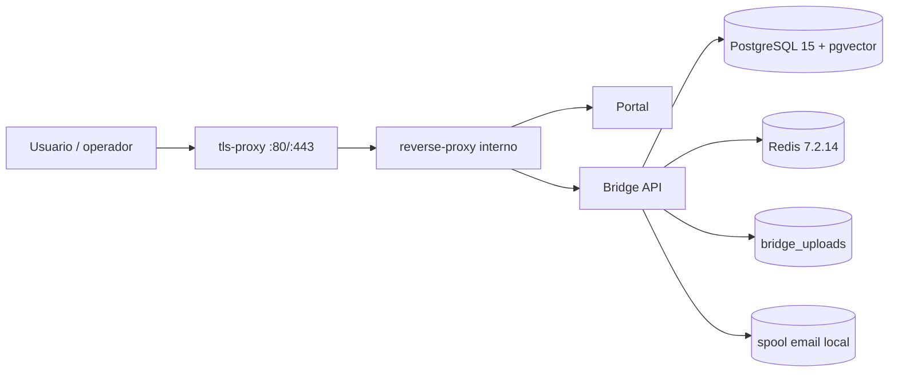
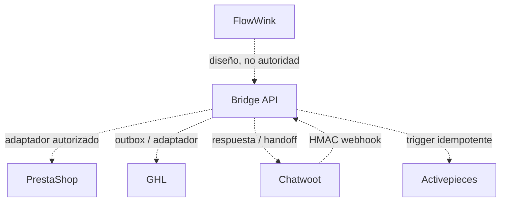

# Mapa de dependencias

## Flujo production core

En `production`, Bridge solo se conecta a `internal` y `data`; se eliminan `extra_hosts` y la red pública. Los proveedores LLM quedan en `none`, el retrieval usa `local_tfidf` y el correo usa spool local. El terminador TLS es el único servicio publicado.

## Dependencias de arranque y disponibilidad

| Consumidor | Dependencia | Comportamiento esperado |
|---|---|---|
| `bridge-api` | PostgreSQL | Migraciones antes de Uvicorn; `/ready` devuelve 503 si DB falla |
| `bridge-api` | Redis | Producción exige backend Redis y fail-closed; `/ready` devuelve 503 si falla |
| `bridge-api` | Workers outbox/scheduler | Producción exige ambos activos; readiness falla si no arrancan |
| `portal` | Bridge vía proxy | Los errores/401 se muestran y la sesión se limpia; no eleva permisos |
| `reverse-proxy` | Portal y Bridge | Espera health de ambos |
| `tls-proxy` | Proxy interno | Espera health y valida certificados mediante preflight |

## Dependencias de build

| Artefacto | Base fijada | Dependencias |
|---|---|---|
| Bridge API | `python:3.12.13-slim-bookworm@sha256:4766…58a2` | `requirements.lock` con hashes; APT desde snapshot 2026-08-14 |
| Portal build | `node:24.18.0-alpine3.24@sha256:a0b9…fbfd` | `package-lock.json`, `npm ci --include=optional` |
| Portal runtime | `nginx:1.30.4-alpine3.24@sha256:97d4…5b46` | Solo assets estáticos y `nginx.conf` |
| Datos | pgvector pg15 por digest | PostgreSQL + extensión vector |
| Coordinación | Redis 7.2.14 Alpine 3.21 BSD-3 por digest | AOF, contraseña; runtime y Trivy verificados |

## Integraciones opcionales

Estas aristas no existen en production core. Requieren credenciales separadas, allowlist de egress, contrato E2E y aprobación de riesgo antes de habilitarse.

## Dependencias que no deben existir

- Portal → base de datos directa.
- LLM → precio, impuesto, stock, numeración o estado contable.
- Vendor → tablas Bridge.
- Servicio externo → acción crítica sin autenticación, idempotencia, política y auditoría Bridge.
- Instancia A → red, volumen, Redis, DB, secreto o backup de instancia B.
