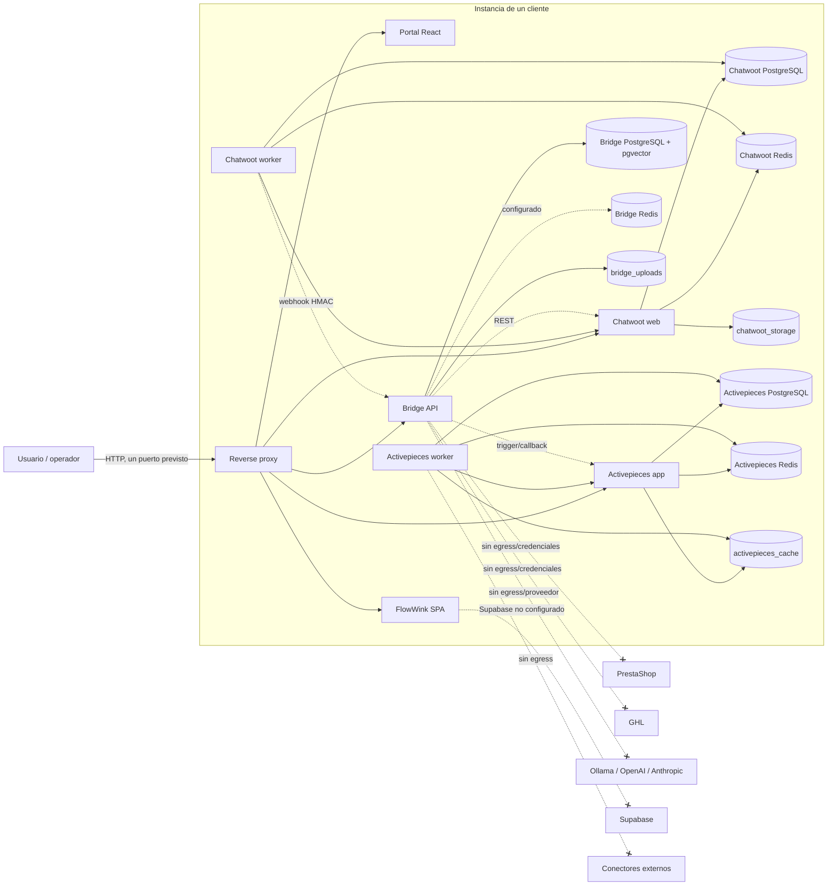
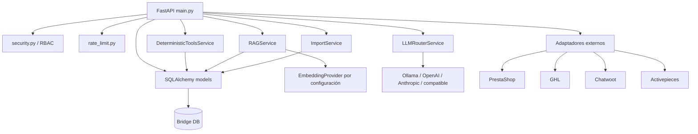
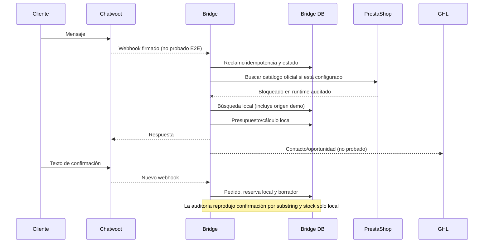

# Mapa de dependencias

## 1. Lectura del mapa

Este documento representa dependencias encontradas en código y Compose al inicio de la remediación. Las aristas continuas existen en la configuración; una arista existente **no** implica que la integración haya funcionado. Las aristas marcadas como bloqueadas reproducen el resultado de la auditoría de runtime del 2026-08-02.

La unidad de aislamiento pretendida es una instalación **multi-instance single-tenant** (`agent-<cliente>`). Todas las dependencias del diagrama deben quedar dentro de esa instalación salvo los proveedores externos explícitamente autorizados.

## 2. Grafo de despliegue actual

### Interpretación

- `public` es la red prevista para el proxy; `internal` comunica frontales, Bridge y vendors; `data` comunica aplicaciones con sus almacenes.
- `internal` y `data` son redes Docker internas. Bridge, Chatwoot y Activepieces no tienen una red de salida dedicada; en la auditoría, una llamada de Bridge a Ollama falló con `Network is unreachable`.
- La inspección actual muestra todos los contenedores detenidos. No se usó el runtime detenido para inferir salud.
- El contenedor histórico del proxy inspeccionado no reflejaba toda la configuración actual de redes/puerto, lo que confirma que `docker-compose.yml` y un contenedor antiguo no deben tratarse como la misma evidencia.

## 3. Dependencias de arranque y salud

| Servicio | Dependencia `depends_on` | Condición | Healthcheck propio | Riesgo de propagación |
|---|---|---|---|---|
| `bridge-api` | `bridge-db`, `bridge-redis` | `service_healthy` | `GET /health` | `/health` devuelve HTTP 200 también cuando la DB está degradada; Compose no usa `/ready` |
| `portal` | Ninguna | — | GET a Nginx local | Acredita solo que se sirve la SPA, no que Bridge ni los módulos funcionen |
| `reverse-proxy` | `portal`, `bridge-api` | `service_healthy` | `/healthz` local | Comprueba el propio Nginx, no los upstreams; en la auditoría el master existía sin workers |
| `chatwoot-web` | `chatwoot-db`, `chatwoot-redis` | `service_healthy` | `/health` | PID obsoleto impidió arrancar Rails aunque DB/Redis estuvieran sanos |
| `chatwoot-worker` | `chatwoot-web` | `service_healthy` | proceso Sidekiq + `ProcessSet` | El canal completo queda bloqueado por el web; no prueba entrega de webhook |
| `activepieces-app` | `activepieces-db`, `activepieces-redis` | `service_healthy` | endpoint de flags | No prueba autenticación, proyecto, flujo ni ejecución |
| `activepieces-worker` | `activepieces-app` | `service_healthy` | proceso Node + flags del app | Puede estar sano sin ejecutar conectores; auditoría observó loops/tráfico anómalo |

`depends_on` ordena el arranque inicial, pero no implementa recuperación transaccional, reconciliación, circuit breaker ni propagación fiable de fallos durante la vida del servicio.

## 4. Dependencias funcionales y contratos

| Origen | Destino | Protocolo/autenticación | Datos intercambiados | Evidencia actual | Efecto si falla |
|---|---|---|---|---|---|
| Navegador | Reverse proxy | HTTP; TLS no implementado en el Compose base | UI, credenciales de login, API | Routing configurado; runtime del proxy roto | Toda la interfaz queda inaccesible |
| Reverse proxy | Portal | HTTP interno | HTML/JS/CSS | Configurado; build frontend previo correcto | Sin UI, aunque Bridge pueda seguir vivo internamente |
| Portal | Bridge | HTTP bearer bajo `/api/bridge/` | Auth, dashboard, costes, aprobaciones | Login/runtime local previo; no E2E de navegador | Portal pierde toda función dinámica |
| Reverse proxy | Bridge | HTTP interno por vhost API | API completa | Configurado; proxy roto en runtime previo | Integraciones/API externas no pueden entrar por el gateway |
| Chatwoot worker/web | Bridge | Webhook JSON con timestamp, HMAC y delivery ID | Mensaje/conversación/contacto | Contrato emisor/receptor revisado y tests sintéticos; no E2E | No se procesa chat ni se genera respuesta/lead |
| Bridge | Chatwoot | REST token | Respuesta a mensaje y estado de conversación | Adaptador presente; token ausente y web roto | No hay respuesta ni handoff; además el handoff actual no asigna equipo/agente |
| Bridge | PrestaShop | HTTPS Basic Auth Webservice, solo lectura | Productos, categorías, características, combinaciones, precios específicos y stock | Código + tests mock; credenciales/sandbox/egress ausentes | Bridge usa copia local; precio/stock pueden ser falsos o antiguos |
| Bridge | GHL | HTTPS bearer/Version header | Contactos, oportunidades y notas | Código + tests mock; credenciales/egress ausentes | Lead externo no se crea o queda parcialmente creado |
| Bridge | Activepieces | HTTP interno con API key | Trigger, payload y referencia de ejecución | Código mock; sin API key/flujos | Automatización no se ejecuta y la evidencia de ejecución puede ser falsa |
| Activepieces | Bridge | Webhook/API interna prevista | Estado/resultado de ejecución | Endpoint propio presente; flujo real ausente | Bridge no puede reconciliar una automatización |
| Bridge | Ollama | HTTP a `host.docker.internal` | Prompt, respuesta, embeddings | Configurado; falló por red en runtime | Agente/RAG remoto no disponible |
| Bridge | OpenAI/Anthropic/compatible | HTTPS bearer | Prompt, respuesta, usage | Implementación de router; sin credenciales ni prueba real | Perfiles avanzados/críticos no disponibles |
| FlowWink | Supabase | HTTPS con URL/clave de proyecto | Estado funcional de la SPA vendorizada | Variables vacías y sin servicio local | FlowWink queda como shell estático |
| Activepieces worker | APIs de terceros | HTTPS, credenciales gestionadas por Activepieces | Automatizaciones externas | Sin egress y sin flujos | Conectores inutilizables |

## 5. Dependencias internas del código propio

### Acoplamientos relevantes

- `bridge-api/app/main.py` concentra rutas, esquemas, flujo conversacional, idempotencia, auditoría y orquestación comercial. Los servicios auxiliares no forman todavía dominios desacoplados.
- El registro de agentes vive en memoria dentro de `main.py`; FlowWink y Activepieces no son su fuente efectiva de configuración.
- `DeterministicToolsService` depende directamente de modelos SQLAlchemy y de la sesión. No existe aún un contrato `CatalogProvider`, `CRMProvider` o repositorio tenant-aware.
- Los adaptadores construyen su configuración desde el singleton global `settings`, lo que encaja con una instancia por cliente, no con selección dinámica de tenant en un proceso compartido.
- Redis está en requisitos y Compose, pero el rate limiter e idempotencia usan memoria/PostgreSQL; no se encontró una dependencia funcional significativa de Bridge Redis.

## 6. Flujo conversacional y comercial actual

Dependencias críticas de este flujo:

1. La entrada depende de proxy + Chatwoot + webhook, ninguno validado E2E.
2. La verdad de precio/stock debería depender de PrestaShop o de un proveedor local explícito con frescura, pero el flujo actual puede caer en catálogo demo.
3. La creación de pedido/reserva no tiene escritura o lock en PrestaShop.
4. GHL ocurre como efecto externo sin outbox transaccional completa.
5. El resultado final depende de varias fuentes sin una saga/reconciliación común.

## 7. Dependencias de datos y volúmenes

| Aplicación | Base/volumen | Acceso previsto | Cobertura del backup revisado | Observación |
|---|---|---|---|---|
| Bridge | `bridge_db_data` | Solo Bridge | Dump PostgreSQL | Incluye negocio, RAG metadata, auditoría e idempotencia |
| Bridge | `bridge_uploads` | Solo Bridge | Archivo tar | Documentos subidos; no hay object storage externo |
| Bridge | `bridge_redis_data` | Solo Bridge Redis | No | Uso de aplicación no demostrado |
| Chatwoot | `chatwoot_db_data` | Web/worker | Dump PostgreSQL | Conversaciones/contactos/configuración Chatwoot |
| Chatwoot | `chatwoot_redis_data` | Web/worker | No | Colas/cache no incluidas |
| Chatwoot | `chatwoot_storage_data` | Web/worker | Archivo tar | Adjuntos/storage |
| Activepieces | `activepieces_db_data` | App/worker | Dump PostgreSQL | Proyectos, flujos, ejecuciones y credenciales cifradas del vendor |
| Activepieces | `activepieces_redis_data` | App/worker | No | Colas/cache no incluidas |
| Activepieces | `activepieces_cache` | App/worker | No | Paquetes/cache compartida; volumen omitido del backup |

## 8. Dependencias de build y supply chain

| Componente | Dependencia de build | Reproducibilidad/evidencia | Riesgo conocido |
|---|---|---|---|
| Bridge | Python >=3.11; requisitos con rangos | Sin lock con hashes | Auditoría encontró advisories en `pypdf` y `Pillow`; ambos procesan uploads |
| Portal | npm + `package-lock.json`; React/Vite/TypeScript | Lock presente; build previo correcto | Auditoría encontró avisos Vite/esbuild y no hay suite frontend |
| FlowWink | Contexto local `vendor/flowwink` | Commit representativo auditado, árbol completo no demostrado | Depende de Supabase no desplegado |
| Chatwoot | Contexto local `vendor/chatwoot` | Dockerfile local difiere del commit declarado en fallback de SHA | Directorio enterprise presente y build pesado |
| Activepieces | Imagen `0.86.3` | Tag, no digest | Sin provenance/firma verificada; vendor local no participa en este runtime |
| PostgreSQL/Redis/Nginx | Tags de imagen | Tags, no digests | Actualización mutable y tres versiones mayores de PostgreSQL |
| Ollama override GPU | `ollama/ollama:latest` | No inmutable | Incumple el requisito de no usar `latest` en producción |

## 9. Puntos únicos y dominios de fallo

- **Reverse proxy:** único punto de entrada y roto en la ejecución auditada.
- **Bridge:** monolito único para auth, negocio, agentes, RAG e integraciones; una caída afecta todo el núcleo.
- **Una DB Bridge por instancia:** favorece el aislamiento, pero no hay réplica/failover ni restore demostrado.
- **Checkout compartido:** los scripts de update cambian el repositorio global; varias instancias que construyan desde el mismo workspace no tienen actualización realmente independiente.
- **Recursos del host:** no existen límites CPU/RAM/PID; la auditoría alcanzó más del 95 % de RAM durante build/arranque.
- **Red de salida:** su ausencia rompe todos los proveedores; añadirla sin allowlist incrementaría SSRF/exfiltración. Debe diseñarse como dependencia explícita y restringida.

## 10. Archivos revisados

- `docker-compose.yml`, overrides en `infrastructure/compose/` y plantilla Nginx.
- Dockerfiles/entrypoints propios de Bridge y Portal.
- `bridge-api/app/main.py`, configuración, modelos, seguridad, rate limit y todos los servicios propios.
- Manifiestos Python y npm/lock del Portal.
- Scripts de provisión, health, backup/restore, update/rollback y configuración.
- Informes y evidencias previos: `docs/audit/02` a `05`, `07`, `08`, `12`, `15`, `17`, `18` y `docs/audit/evidence/`.
- Vendor no se recorrió de forma exhaustiva; se reutilizó la evidencia focalizada ya auditada.

## 11. Dependencias pendientes de validar

- Contratos reales y versiones soportadas de PrestaShop, GHL, Chatwoot y Activepieces.
- Egress con DNS/firewall/allowlist, incluido `host.docker.internal`, sin ampliar SSRF.
- Flujo completo navegador/chat -> proxy -> Bridge -> proveedor -> respuesta.
- Locks, outbox, retries, circuit breakers y reconciliación bajo fallos parciales.
- Restore aislado de todos los almacenes y comportamiento de colas tras recuperar.
- Compatibilidad de releases y migraciones entre versiones; no se ejecutó update/rollback.
- Métricas y alertas que permitan observar cada arista crítica.
